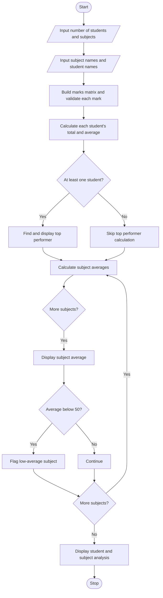

# Flowchart – Student Marks Matrix Analysis

The flowchart below is written in Mermaid. GitHub renders the diagram automatically when this Markdown file is opened. A PNG copy is also provided below.

## Mermaid source

