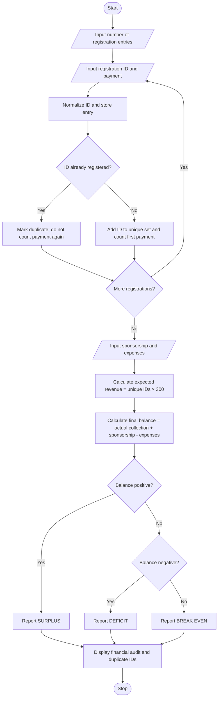

# Flowchart – Campus Festival Registration and Financial Audit

This flowchart is provided in two viewable forms: the rendered PNG below and the editable Mermaid diagram source.

## Mermaid source

